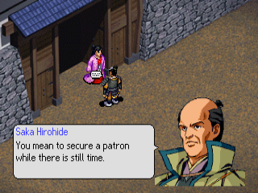
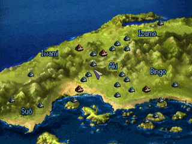
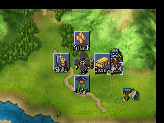
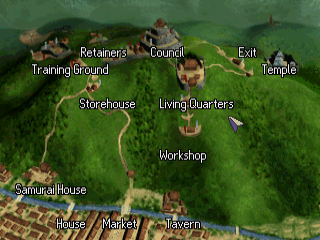
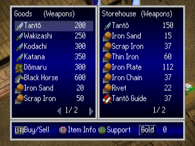
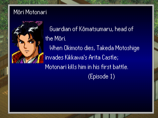

# Mōri Motonari: Chikai no Sanshi — English Translation

A fan translation of **Mōri Motonari: Chikai no Sanshi** (毛利元就 誓いの三矢, "Mōri Motonari:
The Oath of the Three Arrows", Koei, 1997) for the PlayStation into English. It is a
story-driven tactics game in Koei's Eiketsuden series: you follow Mōri Motonari's life episode
by episode, from his first battle as a minor lord in Aki through the wars with the Ōuchi and
the Amago, the surprise attack at Itsukushima and the rise of the Mōri across western Japan,
and on to the campaigns of his sons and grandson. Between the hex-map battles you talk with
your retainers, equip your officers, and visit the merchant, the workshop and the storehouse.
The game was only released in Japan.

> **This is a full machine translation.** All of the game's text was translated from
> Japanese by an AI model, not by a human translator, and it has not been
> proofread by a fluent Japanese speaker. Expect occasional mistranslations, awkward
> phrasing and inconsistent terms. Corrections are welcome.

> **This is a beta.** All of the game's text is in English, but only the first episodes and
> battles have been played through in the emulator; the later episodes were checked as text
> (line lengths, box sizes), not in play. Expect some text that is squeezed, cut short or
> wrapped oddly.

This repository contains the English text and the tools that build the patch.
It does **not** contain the game, any of its data, or the Japanese script — you need
your own copy of the game.

## Screenshots

| | | |
|:-:|:-:|:-:|
|  |  |  |
| Event dialogue | March map | Battle |
|  |  |  |
| Town map | Merchant | Officer biography |

## What's translated

- All event scripts: every episode's dialogue, narration, place captions, chapter and
  episode titles, battle victory and defeat conditions and the choices
- Officer and speaker names (romanised, with macrons for long vowels: Mōri, Ōuchi, Sue
  Harukata), item, skill and unit type names
- All item and skill descriptions, sortie and retreat lines, drill lines
- The officer biographies (People screen)
- Menus, labels, battle messages, the merchant, workshop and storehouse screens, the
  settings menu, the save/load screens and the memory card save titles
- Graphics: the labels of the status, list and battle screens and the province names on
  the march maps, redrawn at build time with an original English font
- A proportional English font (original drawings) with word wrap and paging

Long names and labels are shortened where the game's boxes are too small.

## Applying the patch (players)

1. Download the release zip (`Mouri_Motonari_English_v<version>.zip`) from the Releases
   page. It contains the patch `mouri_motonari_en_v<version>.xdelta`, a `.cue` file and a
   README.txt.
2. You need an unmodified image of the original Japanese disc (serial `SLPS-01285`; the
   later Koei the Best `SLPM-86301` and Koei Teiban `SLPM-86994` reissues are different
   discs) as a single-track BIN/CUE:

   | Mouri Motonari - Chikai no Sanshi (Japan).bin | |
   |---|---|
   | Size  | 393,193,248 bytes |
   | CRC32 | `F21FE1CB` |
   | MD5   | `63fe31be821d6f5438cd4f0bd985792a` |
   | SHA-1 | `47e52e18ff3f88dc7b3c08b5fd0de63e912dadef` |

3. Apply the patch with an xdelta tool, e.g.
   [Delta Patcher](https://github.com/marco-calautti/DeltaPatcher) or the command line:

   ```
   xdelta3 -d -s "Mouri Motonari - Chikai no Sanshi (Japan).bin" mouri_motonari_en_v<version>.xdelta "Mouri Motonari - Chikai no Sanshi (English v<version>).bin"
   ```

4. Put the zip's `Mouri Motonari - Chikai no Sanshi (English v<version>).cue` next to the
   patched .bin and open the `.cue` in your emulator.

The patched disc has the same serial, so it uses the same memory card saves as the
Japanese game.

## Building from source

Requirements: Python 3.10+, `xdelta3` (for the patch file).

```
python -m venv .venv
.venv/bin/pip install -r requirements.txt
cp "/path/to/Mouri Motonari - Chikai no Sanshi (Japan).bin" mouri_motonari.bin
.venv/bin/python tools/setup.py      # checks the disc, extracts script/ from it
.venv/bin/python tools/build.py      # writes build/mouri_motonari_en.bin (+ .cue) and the .xdelta
```

`tools/setup.py` checks the disc's SHA-1 and generates `script/`, which holds the
Japanese text from your disc for the translation tools. `script/` and `build/` are
never committed.

To make a release package, run `.venv/bin/python tools/package.py <version>` after building:
it writes `release/Mouri_Motonari_English_v<version>.zip` with the versioned xdelta patch,
the `.cue` and a plain-text README.txt. No disc data is ever packaged.

## Repository layout

| Path | Contents |
|---|---|
| `tl/eex/` | English for the event scripts `DATA/R_*.EEX` (episodes) and `DATA/S_*.EEX` (battles), one file per script, by string number (`@N`, `@N.K` = speech K of a dialogue) |
| `tl/names/` | Officer and speaker names |
| `tl/data.txt`, `tl/imsg/` | Item and skill names (`DATA/DATA.E3`); item descriptions and battle lines (`DATA/IMSG.E3`) |
| `tl/profile/` | Officer biographies (`DATA/PROFILE.E3`) |
| `tl/progstr/` | English for strings in the game program, by address |
| `tl/gfx.txt` | Text drawn into the screen label graphics |
| `tools/setup.py`, `tools/build.py` | Create `script/`; build the patched disc and the patch |
| `tools/tl.py`, `tools/text.py` | Validates translations, line wrapping and page layout (`apply`, `show`, `check`, `stats`) |
| `tools/iso.py`, `eex.py` | Disc image (ISO 9660, EDC/ECC, the game's own file table), event script format |
| `tools/names.py`, `datae3.py`, `imsg.py`, `bios.py` | Names, game data records, item descriptions, biographies |
| `tools/progstr.py`, `fmtlimit.py`, `mctitle.py` | Program strings; format-string buffer limits; memory card save title |
| `tools/vwf.py`, `pixfont.py`, `asm.py` | Proportional font (original drawings), word wrap and layout patches; small MIPS assembler |
| `tools/gfx.py`, `mmap.py`, `tinyfont.py` | Redrawn graphics (screen labels, march-map province names) |
| `tools/package.py` | Makes the release zip (patch + .cue + README.txt with checksums) |
| `tools/dev/`, `tools/emu/` | Development helpers (disassembly, DuckStation automation) |
| `docs/screenshots/` | README screenshots |

## Known issues

- The title logo and the movies are unchanged.
- Most episodes after the first have not been seen in play. Their text may overflow in places.
- Some labels are squeezed to fit narrow boxes, and some are abbreviated.

Tested in DuckStation only. Bug reports with a screenshot and where it happened are welcome.

## Credits

- Translation and hacking: [damon-daemon](https://github.com/damon-daemon)
- Mōri Motonari: Chikai no Sanshi © Koei Tecmo. This is an unofficial fan project, not
  affiliated with or endorsed by Koei Tecmo. Please support the official releases.

## License

The tools, fonts, documentation and English translation text in this repository
are released under the [MIT License](LICENSE). This covers only original work in
this repository: the game itself and all of its content (code, Japanese text,
graphics, audio) are copyright Koei Tecmo and are not included or licensed here.
